# X3M Ideas: Agency Life Simulation — Database Architecture Blueprint

**Status:** Approved Architecture Blueprint (v2 — Ready for Phase 1 Implementation)  
**Target Stack:** PostgreSQL (Supabase) · Supabase Auth · Prisma ORM · `pgvector` (Phase 4) · Next.js App Router (Server-Authoritative)  
**Sources of Truth:** PRD, GDD, Game Architecture Skill, Game Mechanics Skill, Database Management Skill, Testing & Code Review Skill, UI/UX Development Skill  

---

## 1. Database Architecture Overview

X3M Ideas: Agency Life Simulation uses a **server-authoritative, relational-first** data architecture hosted on **Supabase PostgreSQL** and accessed through **Prisma ORM** from Next.js server-side services (Route Handlers, Server Actions, and Server Components).

### Core Architectural Principles

1. **Authentication vs. Application Data Separation:**
   - **Supabase Auth (`auth.users`)** is the sole source of truth for authentication credentials, password hashes, OAuth identities, email verification, canonical user email, and JWT session issuance.
   - **Application Database (`public` schema)** owns all gameplay state: player profiles, characters, employment records, briefs, financial ledgers, HR history, office state, and AI logs.
   - `players.supabase_auth_id` (`UUID`, `UNIQUE`) logically links each authenticated Supabase user to their application `Player` record. **Prisma migrations do not create or manage a cross-schema foreign key into Supabase's `auth.users` schema**; referential linkage is enforced by the server-side authentication and onboarding services.
2. **Identity Decoupled from Employment:**
   - A player's identity (`Player`, `PlayerProfile`, `Wallet`, `InventoryItem`, `PlayerAchievement`) persists across their entire lifetime.
   - Employment (`Employee`, `CareerHistory`, `HRRecord`) is a separate, stateful lifecycle. Termination changes employment status and preserves history rather than deleting the player's account, wallet, items, or achievements, enabling a clean re-employment path.
3. **Organisational Units Decoupled from Career Tracks:**
   - **Career Tracks** define profession (Copywriting, Art Direction, Brand Strategy, Digital Strategy, Brand Management).
   - **Organisation Units** define workplace placement: Business Units (`BU1`, `BU2`, `BU3`) and Functional Departments (`Finance`, `HR`).
   - A Copywriter can be assigned to `BU1`, while a Brand Strategist can also sit in `BU1`. Both structures are data-driven and extensible.
4. **Server-Authoritative Rules & Append-Only Historical Ledgers:**
   - The browser and 3D scene (`Three.js` / `React Three Fiber`) are presentation layers only.
   - All consequential writes (salaries, brief rewards, marketplace purchases, promotions, deadlines, HR penalties, game clock ticks) are validated and executed inside server-side services using atomic PostgreSQL transactions (`prisma.$transaction`).
   - Financial, career, salary, performance, and disciplinary records are append-only histories protected against accidental cascade deletion.
5. **AI Isolation & Deferred RAG Readiness:**
   - Gemini API outputs (subjective brief evaluations, salary negotiation dialogue, contextual NPC dialogue) are stored as structured records and validated by backend services. AI never writes directly to `wallets`, `employees`, `transactions`, or `hr_records`.
   - `pgvector` and RAG knowledge tables are deferred to **Phase 4**; no embedding model or vector dimension is locked before Phase 4 implementation.
6. **Supabase Dual-Connection Topology & Environment Alignment:**
   - **Runtime (`DATABASE_URL`)**: Supabase Transaction Pooler (port `6543`, `?pgbouncer=true&connect_timeout=20`) for high-concurrency Next.js queries.
   - **Migrations (`DIRECT_URL`)**: Supabase Session Pooler (port `5432`, `?connect_timeout=20`, without `pgbouncer=true`) for IPv4-compatible Prisma CLI migrations.
   - **Supabase Public Key Alignment:** The existing application configuration (`src/lib/supabase/client.ts`, `src/lib/supabase/server.ts`, `src/middleware.ts`, `.env.example`, `.env.local`) currently references `NEXT_PUBLIC_SUPABASE_ANON_KEY`, which holds the project's modern Supabase publishable key (`sb_publishable_...`). Existing variable names must not be renamed unilaterally without a coordinated code and environment update (tracked in Section 10).

---

## 2. Domain Breakdown & Phasing Classification

To avoid over-engineering the initial release while preserving clean extensibility, every entity is classified into one of three tiers:

| Tier | Phase | Scope |
| :--- | :--- | :--- |
| **Foundational** | Phase 1 | Identity, character customisation, organisation units, career tracks, job roles/levels, fictional salary bands, active employment & career history |
| **MVP (Playable Core)** | Phase 2 | Briefs, versioning/rubrics, questions, assignments, submissions, AI/objective evaluations, virtual wallet, append-only transactions, marketplace, inventory, basic HR/performance, per-player server game clock |
| **Later-Stage Expansion** | Phase 3 & 4 | Recruitment/negotiation transcripts, savings & recurring expenses, NPCs & schedules, relationships & dialogue libraries, TGIT office events, achievements, notifications, deferred `pgvector` RAG knowledge base |

### Ten Database Domains

| # | Domain | Tier | Core Responsibility |
| :-: | :--- | :--- | :--- |
| 1 | **Player Identity & Character Profiles** | Foundational | Links Supabase Auth user to persistent player account and 3D avatar customisation |
| 2 | **Organisation Structure** | Foundational | Represents `BU1`, `BU2`, `BU3`, `Finance`, `HR`, and 3D office zones |
| 3 | **Career Tracks, Roles & Salary Bands** | Foundational | Configurable 5-track career ladders (5 provisional levels each), track-specific role titles (incl. Deputy Creative Director), and fictional game NGN salary bands |
| 4 | **Employment, Recruitment & Career History** | Foundational / MVP | Active employment state, promotions, salary negotiations, and historical employment spells (incl. re-employment) |
| 5 | **Briefs, Questions, Submissions & Evaluations** | MVP | General & role-specific briefs, immutable versioned rubrics, objective MCQs, player submissions, deterministic & Gemini evaluations |
| 6 | **Performance, Warnings & HR** | MVP | Performance metrics, HR queries, warnings, probation, termination, and recovery activities |
| 7 | **Virtual Economy, Wallets, Savings & Assets** | MVP / Later | Virtual NGN wallet, append-only transaction ledger, salary payouts, marketplace items with resale valuation, inventory, savings, recurring expenses |
| 8 | **NPCs, Dialogue, Interactions & Office Events** | Later (Phase 3) | Scheduled NPC colleagues, office banter libraries, player-NPC relationships, TGIT Thursday events |
| 9 | **Game Clock, Settings, Progression & Achievements** | MVP / Later | Per-player server-authoritative 2x clock, offline catch-up, absence protection, configurable rules, achievements, notifications |
| 10 | **AI Interactions & Knowledge Base (RAG)** | MVP / Later (Phase 4) | AI audit logs (Phase 2); deferred curated advertising knowledge sources, `pgvector` chunks, and fixed brief reference links (Phase 4) |

---

## 3. Entity Relationship Diagram

```mermaid
erDiagram
    SUPABASE_AUTH_USERS ||..|| PLAYER : "logical 1:1 (supabase_auth_id, no cross-schema FK)"
    PLAYER ||--|| PLAYER_PROFILE : "1:1"
    PLAYER ||--|| WALLET : "1:1"
    PLAYER ||--|| GAME_CLOCK_STATE : "1:1 (per-player clock)"
    PLAYER ||--o{ EMPLOYEE : "1:N (employment spells)"
    PLAYER ||--o{ PLAYER_ACHIEVEMENT : "1:N"
    PLAYER ||--o{ NOTIFICATION : "1:N"

    ORGANISATION_UNIT ||--o{ EMPLOYEE : "1:N"
    ORGANISATION_UNIT ||--o{ OFFICE_LOCATION : "1:N"
    ORGANISATION_UNIT ||--o{ NPC : "1:N"

    CAREER_TRACK ||--o{ JOB_ROLE : "1:N"
    SALARY_BAND ||--o{ JOB_ROLE : "1:N"
    JOB_ROLE ||--o{ EMPLOYEE : "1:N (composite FK with career_track_id)"

    EMPLOYEE ||--o{ CAREER_HISTORY : "1:N"
    EMPLOYEE ||--o{ SALARY_NEGOTIATION : "1:N"
    EMPLOYEE ||--o{ BRIEF_ASSIGNMENT : "1:N"
    EMPLOYEE ||--o{ PERFORMANCE_RECORD : "1:N"
    EMPLOYEE ||--o{ HR_RECORD : "1:N"
    EMPLOYEE ||--o{ EVENT_PARTICIPATION : "1:N"

    BRIEF ||--o{ BRIEF_VERSION : "1:N (is_current partial unique)"
    CAREER_TRACK ||--o{ BRIEF : "1:N (nullable for General)"
    BRIEF_VERSION ||--o{ BRIEF_QUESTION : "1:N"
    BRIEF_VERSION ||--o{ BRIEF_ASSIGNMENT : "1:N"
    BRIEF_ASSIGNMENT ||--o| BRIEF_SUBMISSION : "1:0..1"
    BRIEF_SUBMISSION ||--o| EVALUATION : "1:0..1"

    WALLET ||--o{ TRANSACTION : "1:N (append-only ledger)"
    WALLET ||--o{ INVENTORY_ITEM : "1:N"
    WALLET ||--o| SAVINGS_ACCOUNT : "1:0..1"
    WALLET ||--o{ RECURRING_EXPENSE : "1:N"
    MARKETPLACE_ITEM ||--o{ INVENTORY_ITEM : "1:N"

    NPC ||--o{ NPC_SCHEDULE : "1:N"
    NPC ||--o{ RELATIONSHIP : "1:N"
    PLAYER ||--o{ RELATIONSHIP : "1:N"
    OFFICE_EVENT ||--o{ EVENT_PARTICIPATION : "1:N"
    ACHIEVEMENT ||--o{ PLAYER_ACHIEVEMENT : "1:N"

    KNOWLEDGE_SOURCE ||--o{ KNOWLEDGE_CHUNK : "1:N (Phase 4 pgvector)"
    BRIEF_VERSION ||--o{ BRIEF_REFERENCE_LINK : "1:N (Phase 4)"
    KNOWLEDGE_SOURCE ||--o{ BRIEF_REFERENCE_LINK : "1:N (Phase 4)"
    PLAYER ||--o{ AI_INTERACTION_LOG : "1:N"
```

---

## 4. Proposed Entities & Field Specifications

> **Conventions:** All primary keys use `UUID` (`@default(uuid())`). Timestamps use `TIMESTAMPTZ` (UTC). Virtual currency (`NGN`) is stored as `INTEGER` (whole Naira; see Section 10). Table names use `snake_case` via `@@map`.

### Domain 1: Player Identity & Character Profiles *(Phase 1 — Foundational)*

#### `players` (`Player`)
| Field | Type | Constraints | Description |
| :--- | :--- | :--- | :--- |
| `id` | `UUID` | PK | Internal application player ID |
| `supabase_auth_id` | `UUID` | `UNIQUE`, `NOT NULL` | Logical reference to `auth.users.id` in Supabase Auth (no cross-schema FK managed by Prisma) |
| `email_snapshot` | `VARCHAR(255)` | Nullable | Non-authoritative cached email for admin/support lookup; **Supabase Auth (`auth.users.email`) remains canonical** |
| `status` | `ENUM(ACTIVE, SUSPENDED, ARCHIVED)` | `DEFAULT ACTIVE` | Account lifecycle status (`ARCHIVED` used for soft-delete) |
| `last_seen_at` | `TIMESTAMPTZ` | `NOT NULL` | Used for offline catch-up and absence protection |
| `archived_at` | `TIMESTAMPTZ` | Nullable | Populated when account is archived rather than hard-deleted |
| `created_at` / `updated_at` | `TIMESTAMPTZ` | `NOT NULL` | Audit timestamps |

#### `player_profiles` (`PlayerProfile`)
| Field | Type | Constraints | Description |
| :--- | :--- | :--- | :--- |
| `id` | `UUID` | PK | Profile ID |
| `player_id` | `UUID` | `UNIQUE`, FK $\rightarrow$ `players.id` (`RESTRICT`) | 1:1 link to `Player` |
| `display_name` | `VARCHAR(80)` | `NOT NULL` | In-game employee name |
| `gender_presentation` | `VARCHAR(32)` | `DEFAULT 'unspecified'` | Character presentation option |
| `avatar_model_key` | `VARCHAR(64)` | `NOT NULL` | Base 3D rig/mesh identifier (e.g., `player-character`) |
| `skin_tone` | `VARCHAR(32)` | `DEFAULT 'default'` | Customisation option |
| `hairstyle` | `VARCHAR(64)` | `DEFAULT 'default'` | Customisation option |
| `outfit_key` | `VARCHAR(64)` | `DEFAULT 'business_casual'` | Currently equipped outfit |
| `avatar_thumbnail_url` | `TEXT` | Nullable | Optional portrait for HUD |
| `absence_protection_until` | `TIMESTAMPTZ` | Nullable | Protects player from unfair deadline penalties when away |
| `created_at` / `updated_at` | `TIMESTAMPTZ` | `NOT NULL` | Audit timestamps |

---

### Domain 2: Organisation Structure *(Phase 1 — Foundational)*

#### `organisation_units` (`OrganisationUnit`)
| Field | Type | Constraints | Description |
| :--- | :--- | :--- | :--- |
| `id` | `UUID` | PK | Unit ID |
| `code` | `VARCHAR(24)` | `UNIQUE`, `NOT NULL` | `BU1`, `BU2`, `BU3`, `FINANCE`, `HR` (extensible) |
| `name` | `VARCHAR(100)` | `NOT NULL` | Display name (e.g., "Business Unit 1") |
| `unit_type` | `ENUM(BUSINESS_UNIT, FUNCTIONAL_DEPARTMENT)` | `NOT NULL` | Distinguishes BUs from Finance/HR |
| `description` | `TEXT` | `NOT NULL` | Unit role in the agency |
| `is_active` | `BOOLEAN` | `DEFAULT true` | Allows adding future units without code changes |
| `created_at` | `TIMESTAMPTZ` | `DEFAULT now()` | Audit timestamp |

#### `office_locations` (`OfficeLocation`) *(Phase 2/3 — 3D Office Binding)*
| Field | Type | Constraints | Description |
| :--- | :--- | :--- | :--- |
| `id` | `UUID` | PK | Location ID |
| `code` | `VARCHAR(48)` | `UNIQUE`, `NOT NULL` | e.g., `RECEPTION`, `BU1_ZONE`, `PANTRY`, `MEETING_ROOM_1` |
| `name` | `VARCHAR(100)` | `NOT NULL` | Human-readable zone name |
| `location_type` | `ENUM(WORK_ZONE, MEETING_ROOM, PANTRY, RECEPTION, MANAGEMENT_OFFICE, FUNCTIONAL_OFFICE)` | `NOT NULL` | Interaction classification |
| `organisation_unit_id` | `UUID` | Nullable, FK $\rightarrow$ `organisation_units.id` (`SET NULL`) | Links zone to BU1–BU3, Finance, or HR |
| `spawn_coordinates` | `JSONB` | `NOT NULL` | `{ x, y, z, rotationY }` in Three.js meters |
| `is_interactable` | `BOOLEAN` | `DEFAULT true` | Controls click-to-move / interaction triggers |

---

### Domain 3: Career Tracks, Job Roles, Levels & Salary Bands *(Phase 1 — Foundational)*

> **Provisional Career Structure & Fictional Economy Note:** The initial design retains **five provisional career levels per track** (Levels 1–5), where **role titles may differ across career tracks** (for example, Creative tracks use titles such as *Copywriter* and *Deputy Creative Director*, while Brand Management or Strategy tracks use discipline-appropriate titles). All `salary_bands` values are **clearly identified fictional game salary bands** designed for gameplay progression and **must never reflect actual X3M Ideas employee salaries**.

#### `career_tracks` (`CareerTrack`)
| Field | Type | Constraints | Description |
| :--- | :--- | :--- | :--- |
| `id` | `UUID` | PK | Track ID |
| `code` | `VARCHAR(32)` | `UNIQUE`, `NOT NULL` | `COPYWRITING`, `ART_DIRECTION`, `BRAND_STRATEGY`, `DIGITAL_STRATEGY`, `BRAND_MANAGEMENT` |
| `name` | `VARCHAR(100)` | `NOT NULL` | Display name |
| `description` | `TEXT` | `NOT NULL` | Track overview shown during onboarding |
| `is_active` | `BOOLEAN` | `DEFAULT true` | Supports adding new tracks later |

#### `salary_bands` (`SalaryBand`)
| Field | Type | Constraints | Description |
| :--- | :--- | :--- | :--- |
| `id` | `UUID` | PK | Band ID |
| `code` | `VARCHAR(32)` | `UNIQUE`, `NOT NULL` | e.g., `GAME_BAND_L1`..`GAME_BAND_L5` (fictional game bands) |
| `label` | `VARCHAR(100)` | `NOT NULL` | Descriptive band label |
| `min_salary` | `INTEGER` | `NOT NULL`, `CHECK (min_salary >= 0)` | Fictional minimum monthly game NGN salary |
| `max_salary` | `INTEGER` | `NOT NULL`, `CHECK (max_salary >= min_salary)` | Fictional maximum monthly game NGN salary |
| `currency` | `VARCHAR(8)` | `DEFAULT 'NGN'` | Virtual currency code |
| `effective_from` | `TIMESTAMPTZ` | `DEFAULT now()` | Supports future salary band revisions |

#### `job_roles` (`JobRole`)
| Field | Type | Constraints | Description |
| :--- | :--- | :--- | :--- |
| `id` | `UUID` | PK | Role ID |
| `career_track_id` | `UUID` | FK $\rightarrow$ `career_tracks.id` (`RESTRICT`) | Owning career track |
| `level` | `INTEGER` | `NOT NULL`, `CHECK (level >= 1)` | Provisional 5-level seniority rank (1 = Entry Level upwards) |
| `title` | `VARCHAR(100)` | `NOT NULL` | Track-specific configurable title (e.g., *Deputy Creative Director* in creative tracks) |
| `description` | `TEXT` | `NOT NULL` | Responsibilities |
| `salary_band_id` | `UUID` | FK $\rightarrow$ `salary_bands.id` (`RESTRICT`) | Authoritative fictional game salary range for negotiation validation |
| `promotion_criteria` | `JSONB` | Nullable | Configurable thresholds (`minBriefs`, `minAvgScore`, `minPerformance`, `minTenureDays`, `requiresAssessment`) |
| `UNIQUE` | — | `(career_track_id, level)` | One role per level per track |
| `UNIQUE` | — | `(career_track_id, id)` | Supports composite FK from `employees` guaranteeing track-role consistency |

---

### Domain 4: Employment, Recruitment, Promotions & Career History *(Phase 1 — Foundational / Phase 2 — Recruitment)*

#### `employees` (`Employee`)
Represents a single **employment spell** for a player. Separating employment spells allows termination and subsequent re-employment while preserving complete history.

| Field | Type | Constraints | Description |
| :--- | :--- | :--- | :--- |
| `id` | `UUID` | PK | Employment record ID |
| `player_id` | `UUID` | FK $\rightarrow$ `players.id` (`RESTRICT`) | Owning player |
| `organisation_unit_id` | `UUID` | FK $\rightarrow$ `organisation_units.id` (`RESTRICT`) | Assigned BU1–BU3 / Finance / HR |
| `career_track_id` | `UUID` | `NOT NULL` | Player's track for this employment spell |
| `job_role_id` | `UUID` | `NOT NULL` | Current designation & level |
| `COMPOSITE FK` | — | `(career_track_id, job_role_id)` $\rightarrow$ `job_roles (career_track_id, id)` (`RESTRICT`) | **Enforces at the database level that `career_track_id` always matches the career track of `job_role_id`** |
| `current_salary` | `INTEGER` | `NOT NULL` | Server-validated monthly game NGN salary |
| `performance_score` | `DOUBLE PRECISION` | `DEFAULT 70.0` | Current rolling performance indicator (0–100) |
| `experience_points` | `INTEGER` | `DEFAULT 0` | Career XP earned from briefs/activities |
| `warning_count` | `INTEGER` | `DEFAULT 0` | Active disciplinary strikes |
| `status` | `ENUM(ONBOARDING, PROBATION, ACTIVE, WARNING_REVIEW, ON_LEAVE, TERMINATED, RESIGNED)` | `DEFAULT PROBATION` | Authoritative employment state |
| `is_current` | `BOOLEAN` | `DEFAULT true` | Partial unique index enforces at most 1 current spell per player |
| `hired_at` | `TIMESTAMPTZ` | `DEFAULT now()` | Employment start date (real time) |
| `hired_game_day` | `INTEGER` | `NOT NULL` | In-game day of hire |
| `terminated_at` | `TIMESTAMPTZ` | Nullable | Populated only if terminated/resigned |
| `updated_at` | `TIMESTAMPTZ` | `NOT NULL` | Last update timestamp |

#### `career_histories` (`CareerHistory`) *(Phase 1 — Foundational)*
| Field | Type | Constraints | Description |
| :--- | :--- | :--- | :--- |
| `id` | `UUID` | PK | History entry ID |
| `employee_id` | `UUID` | FK $\rightarrow$ `employees.id` (`RESTRICT`) | Employment spell (protected against cascade deletion) |
| `event_type` | `ENUM(HIRED, PROMOTED, TRANSFERRED, SALARY_ADJUSTED, TERMINATED, REHIRED)` | `NOT NULL` | Type of career milestone |
| `role_title_snapshot` | `VARCHAR(100)` | `NOT NULL` | Preserved title even if `job_roles` is later edited |
| `level_snapshot` | `INTEGER` | `NOT NULL` | Preserved level |
| `unit_name_snapshot` | `VARCHAR(100)` | `NOT NULL` | Preserved BU / department name |
| `salary_snapshot` | `INTEGER` | `NOT NULL` | Salary effective at this milestone |
| `notes` | `TEXT` | Nullable | Human-readable summary |
| `effective_at` | `TIMESTAMPTZ` | `DEFAULT now()` | Real-world timestamp |
| `effective_game_day` | `INTEGER` | `NOT NULL` | In-game calendar day |

#### `salary_negotiations` (`SalaryNegotiation`) *(Phase 2 — MVP)*
| Field | Type | Constraints | Description |
| :--- | :--- | :--- | :--- |
| `id` | `UUID` | PK | Negotiation ID |
| `employee_id` | `UUID` | FK $\rightarrow$ `employees.id` (`RESTRICT`) | Employee negotiating (history preserved) |
| `target_job_role_id` | `UUID` | FK $\rightarrow$ `job_roles.id` (`RESTRICT`) | Role being negotiated for |
| `context` | `ENUM(RECRUITMENT, PROMOTION, RE_EMPLOYMENT)` | `NOT NULL` | Negotiation trigger |
| `band_min_snapshot` | `INTEGER` | `NOT NULL` | Snapshot of approved fictional minimum salary |
| `band_max_snapshot` | `INTEGER` | `NOT NULL` | Snapshot of approved fictional maximum salary |
| `initial_offer` | `INTEGER` | `NOT NULL` | Opening agency offer |
| `player_requested_salary` | `INTEGER` | Nullable | Player's counter-offer |
| `final_agreed_salary` | `INTEGER` | Nullable | Backend-clamped final approved salary (`CHECK` within band) |
| `status` | `ENUM(IN_PROGRESS, ACCEPTED, REJECTED, EXPIRED)` | `DEFAULT IN_PROGRESS` | Negotiation state |
| `transcript` | `JSONB` | `DEFAULT '[]'` | Structured conversation turns with AI recruiter/manager |
| `created_at` / `resolved_at` | `TIMESTAMPTZ` | — | Timestamps |

---

### Domain 5: Briefs, Questions, Submissions & Evaluations *(Phase 2 — MVP)*

#### `briefs` (`Brief`)
| Field | Type | Constraints | Description |
| :--- | :--- | :--- | :--- |
| `id` | `UUID` | PK | Logical brief ID |
| `slug` | `VARCHAR(80)` | `UNIQUE`, `NOT NULL` | Stable seed/content identifier |
| `category` | `ENUM(GENERAL, ROLE_SPECIFIC, RECOVERY, EVENT_SPECIAL)` | `NOT NULL` | Brief classification |
| `career_track_id` | `UUID` | Nullable, FK $\rightarrow$ `career_tracks.id` (`RESTRICT`) | `NULL` for General briefs; set for Role-Specific |
| `min_level` | `INTEGER` | `DEFAULT 1` | Minimum career level eligibility |
| `max_level` | `INTEGER` | Nullable | Optional upper level cap |
| `status` | `ENUM(DRAFT, ACTIVE, ARCHIVED)` | `DEFAULT ACTIVE` | Lifecycle status |
| `created_at` / `updated_at` | `TIMESTAMPTZ` | `NOT NULL` | Timestamps |

> **Circular Reference Avoidance:** `briefs` does **not** hold a `current_version_id` foreign key back to `brief_versions`. Instead, `brief_versions.is_current` with a partial unique index (`WHERE is_current = true`) identifies the single active version per brief, eliminating circular FKs and making it impossible for a brief to point to another brief's version.

#### `brief_versions` (`BriefVersion`)
Guarantees **brief versioning and consistent evaluation rubrics**: once a player is assigned a brief version, subsequent edits publish a new version (`version_number + 1`) and toggle `is_current` atomically inside a transaction, leaving all existing assignments pinned to their original version and rubric.

| Field | Type | Constraints | Description |
| :--- | :--- | :--- | :--- |
| `id` | `UUID` | PK | Version ID |
| `brief_id` | `UUID` | FK $\rightarrow$ `briefs.id` (`RESTRICT`) | Parent brief |
| `version_number` | `INTEGER` | `NOT NULL` | Monotonic version (`1, 2, 3...`) |
| `is_current` | `BOOLEAN` | `DEFAULT false`, `NOT NULL` | Partial unique index ensures at most one `true` per `brief_id` |
| `title` | `VARCHAR(160)` | `NOT NULL` | Brief title |
| `introduction` | `TEXT` | `NOT NULL` | Story/context introduction |
| `instructions` | `TEXT` | `NOT NULL` | Detailed prompt & deliverables |
| `format` | `ENUM(MULTIPLE_CHOICE, TRIVIA, SCENARIO_DECISION, SHORT_WRITTEN, CREATIVE_SUBMISSION)` | `NOT NULL` | Submission format |
| `evaluation_method` | `ENUM(OBJECTIVE_DETERMINISTIC, SUBJECTIVE_AI_RUBRIC, HYBRID)` | `NOT NULL` | Scoring engine selector |
| `difficulty` | `INTEGER` | `DEFAULT 1`, `CHECK (1..5)` | Difficulty tier |
| `base_reward` | `INTEGER` | `NOT NULL` | Base NGN reward |
| `xp_reward` | `INTEGER` | `DEFAULT 20` | Base XP reward |
| `deadline_game_hours` | `INTEGER` | `NOT NULL` | Duration in in-game hours |
| `rubric_snapshot` | `JSONB` | Nullable | Fixed scoring criteria, weights, and max points for AI grading |
| `reference_snapshot` | `TEXT` | Nullable | Frozen approved reference notes for deterministic AI consistency |
| `published_at` | `TIMESTAMPTZ` | `DEFAULT now()` | Version publish time |
| `UNIQUE` | — | `(brief_id, version_number)` | Unique version per brief |

#### `brief_questions` (`BriefQuestion`)
Used for deterministic objective formats (`MULTIPLE_CHOICE`, `TRIVIA`, `SCENARIO_DECISION`).

| Field | Type | Constraints | Description |
| :--- | :--- | :--- | :--- |
| `id` | `UUID` | PK | Question ID |
| `brief_version_id` | `UUID` | FK $\rightarrow$ `brief_versions.id` (`RESTRICT`) | Owning brief version |
| `order_index` | `INTEGER` | `NOT NULL` | Display sequence |
| `prompt` | `TEXT` | `NOT NULL` | Question text |
| `options` | `JSONB` | `NOT NULL` | Array of `{ key, label }` choices |
| `correct_option_key` | `VARCHAR(32)` | `NOT NULL` | Approved answer key (never sent to client before grading) |
| `explanation` | `TEXT` | `NOT NULL` | Post-submission learning explanation |
| `points` | `INTEGER` | `DEFAULT 10` | Point weight |

#### `brief_assignments` (`BriefAssignment`)
| Field | Type | Constraints | Description |
| :--- | :--- | :--- | :--- |
| `id` | `UUID` | PK | Assignment ID |
| `employee_id` | `UUID` | FK $\rightarrow$ `employees.id` (`RESTRICT`) | Assigned employee |
| `brief_version_id` | `UUID` | FK $\rightarrow$ `brief_versions.id` (`RESTRICT`) | Frozen version assigned to player |
| `status` | `ENUM(PENDING, IN_PROGRESS, SUBMITTED, EVALUATED, EXPIRED, CANCELLED)` | `DEFAULT PENDING` | Assignment lifecycle |
| `assigned_at` | `TIMESTAMPTZ` | `DEFAULT now()` | Server real-world assign time |
| `due_at` | `TIMESTAMPTZ` | `NOT NULL` | Server-computed real-world deadline |
| `due_game_timestamp` | `TIMESTAMPTZ` | `NOT NULL` | Corresponding in-game deadline |
| `grace_period_ends_at` | `TIMESTAMPTZ` | Nullable | Configurable grace window |
| `outcome` | `ENUM(EXCELLENT, SUCCESS, PARTIAL, UNSUCCESSFUL, MISSED_DEADLINE)` | Nullable | Final backend-assigned outcome |

#### `brief_submissions` (`BriefSubmission`)
| Field | Type | Constraints | Description |
| :--- | :--- | :--- | :--- |
| `id` | `UUID` | PK | Submission ID |
| `assignment_id` | `UUID` | `UNIQUE`, FK $\rightarrow$ `brief_assignments.id` (`RESTRICT`) | 1:1 per assignment (prevents duplicate submissions) |
| `objective_answers` | `JSONB` | Nullable | Map of `{ questionId: selectedOptionKey }` |
| `written_response` | `TEXT` | Nullable | Player's subjective/creative response |
| `is_late` | `BOOLEAN` | `DEFAULT false` | Computed by backend against server clock |
| `submitted_at` | `TIMESTAMPTZ` | `DEFAULT now()` | Authoritative server timestamp |

#### `evaluations` (`Evaluation`)
| Field | Type | Constraints | Description |
| :--- | :--- | :--- | :--- |
| `id` | `UUID` | PK | Evaluation ID |
| `submission_id` | `UUID` | `UNIQUE`, FK $\rightarrow$ `brief_submissions.id` (`RESTRICT`) | 1:1 per submission |
| `evaluator_type` | `ENUM(DETERMINISTIC_ENGINE, GEMINI_AI, HYBRID)` | `NOT NULL` | Grading source |
| `model_name` | `VARCHAR(64)` | Nullable | e.g., `gemini-2.5-flash` |
| `score` | `INTEGER` | `NOT NULL`, `CHECK (0..100)` | Validated numeric score |
| `summary` | `TEXT` | `NOT NULL` | Concise summary |
| `feedback` | `TEXT` | `NOT NULL` | Actionable feedback |
| `strengths` | `TEXT` | Nullable | Identified strengths |
| `improvements` | `TEXT` | Nullable | Areas for improvement |
| `supporting_references` | `JSONB` | Nullable | Relevant concepts/references cited |
| `rubric_version_snapshot` | `JSONB` | Nullable | Exact rubric applied at grading time |
| `raw_ai_response` | `JSONB` | Nullable | Raw validated JSON payload for auditability |
| `evaluated_at` | `TIMESTAMPTZ` | `DEFAULT now()` | Timestamp |

---

### Domain 6: Performance, Warnings & HR *(Phase 2 — MVP)*

#### `performance_records` (`PerformanceRecord`)
Append-only audit trail explaining every change to `employees.performance_score`.

| Field | Type | Constraints | Description |
| :--- | :--- | :--- | :--- |
| `id` | `UUID` | PK | Record ID |
| `employee_id` | `UUID` | FK $\rightarrow$ `employees.id` (`RESTRICT`) | Target employee (protected against cascade deletion) |
| `source_type` | `ENUM(BRIEF_EVALUATION, MISSED_DEADLINE, RECOVERY_ACTIVITY, OFFICE_EVENT, ACHIEVEMENT, HR_ADJUSTMENT)` | `NOT NULL` | Trigger source |
| `source_reference_id` | `UUID` | Nullable | Links to assignment, event, or HR record |
| `score_delta` | `DOUBLE PRECISION` | `NOT NULL` | Change applied (e.g., `+6.5`, `-8.0`) |
| `score_after` | `DOUBLE PRECISION` | `NOT NULL` | Snapshot after mutation |
| `reason` | `VARCHAR(255)` | `NOT NULL` | Player-visible explanation |
| `created_at` | `TIMESTAMPTZ` | `DEFAULT now()` | Timestamp |

#### `hr_records` (`HRRecord`)
| Field | Type | Constraints | Description |
| :--- | :--- | :--- | :--- |
| `id` | `UUID` | PK | HR record ID |
| `employee_id` | `UUID` | FK $\rightarrow$ `employees.id` (`RESTRICT`) | Target employee (protected against cascade deletion) |
| `action_type` | `ENUM(QUERY, INFORMAL_WARNING, FORMAL_WARNING, PERFORMANCE_REVIEW, PROBATION, SUSPENSION, TERMINATION, COMMENDATION, RECOVERY_COMPLETED)` | `NOT NULL` | HR event category |
| `severity` | `INTEGER` | `DEFAULT 1`, `CHECK (1..5)` | Escalation severity |
| `reason` | `TEXT` | `NOT NULL` | Explicit rule-based reason |
| `trigger_reference_id` | `UUID` | Nullable | e.g., missed `BriefAssignment` ID |
| `status` | `ENUM(OPEN, ACKNOWLEDGED, RESOLVED, APPEALED)` | `DEFAULT OPEN` | Resolution state |
| `issued_at` | `TIMESTAMPTZ` | `DEFAULT now()` | Issued timestamp |
| `resolved_at` | `TIMESTAMPTZ` | Nullable | Resolution timestamp |

---

### Domain 7: Virtual Economy, Wallets, Savings & Assets *(Phase 2 — MVP / Phase 3 — Savings & Expenses)*

#### `wallets` (`Wallet`) *(Phase 2 — MVP)*
| Field | Type | Constraints | Description |
| :--- | :--- | :--- | :--- |
| `id` | `UUID` | PK | Wallet ID |
| `player_id` | `UUID` | `UNIQUE`, FK $\rightarrow$ `players.id` (`RESTRICT`) | 1:1 per player (persists across employment spells) |
| `balance` | `INTEGER` | `DEFAULT 50000`, `CHECK (balance >= 0)` | Current liquid virtual NGN balance |
| `currency` | `VARCHAR(8)` | `DEFAULT 'NGN'` | Virtual currency only |
| `updated_at` | `TIMESTAMPTZ` | `NOT NULL` | Last balance mutation |

#### `transactions` (`Transaction`) *(Phase 2 — MVP)*
**Append-only transaction ledger** (not double-entry accounting). Every mutation to `wallets.balance` must insert a corresponding row in `transactions` within the same database transaction.

| Field | Type | Constraints | Description |
| :--- | :--- | :--- | :--- |
| `id` | `UUID` | PK | Transaction ID |
| `wallet_id` | `UUID` | FK $\rightarrow$ `wallets.id` (`RESTRICT`) | Owning wallet (protected against cascade deletion) |
| `idempotency_key` | `VARCHAR(128)` | `UNIQUE`, `NOT NULL` | Prevents duplicate salaries, rewards, or purchases (e.g., `salary:{empId}:{gameMonth}`) |
| `type` | `ENUM(SALARY, BRIEF_REWARD, BONUS, EVENT_REWARD, MARKETPLACE_PURCHASE, ASSET_RESALE, RECURRING_EXPENSE, SAVINGS_DEPOSIT, SAVINGS_WITHDRAWAL, ADJUSTMENT)` | `NOT NULL` | Transaction category |
| `direction` | `ENUM(CREDIT, DEBIT)` | `NOT NULL` | Explicit sign direction |
| `amount` | `INTEGER` | `NOT NULL`, `CHECK (amount > 0)` | Positive magnitude in NGN |
| `balance_after` | `INTEGER` | `NOT NULL` | Post-transaction balance snapshot |
| `description` | `VARCHAR(255)` | `NOT NULL` | Ledger label |
| `reference_type` | `VARCHAR(48)` | Nullable | e.g., `BRIEF_ASSIGNMENT`, `MARKETPLACE_ITEM`, `PAYROLL_CYCLE` |
| `reference_id` | `UUID` | Nullable | Entity ID linked to this transaction |
| `created_at` | `TIMESTAMPTZ` | `DEFAULT now()` | Immutable timestamp |

#### `marketplace_items` (`MarketplaceItem`) *(Phase 2 — MVP)*
| Field | Type | Constraints | Description |
| :--- | :--- | :--- | :--- |
| `id` | `UUID` | PK | Item ID |
| `slug` | `VARCHAR(80)` | `UNIQUE`, `NOT NULL` | Stable catalogue identifier |
| `name` | `VARCHAR(120)` | `NOT NULL` | Item name |
| `category` | `ENUM(CLOTHING, GADGET, ACCOMMODATION, VEHICLE, FURNITURE, LIFESTYLE)` | `NOT NULL` | Marketplace category |
| `description` | `TEXT` | `NOT NULL` | Item flavour text |
| `price` | `INTEGER` | `NOT NULL`, `CHECK (price >= 0)` | Purchase cost in NGN |
| `resale_value` | `INTEGER` | Nullable, `CHECK (resale_value >= 0)` | Explicit resale valuation for net worth & resale (if `NULL`, derived via `resale_rate_bps`) |
| `resale_rate_bps` | `INTEGER` | `DEFAULT 7000`, `CHECK (0..10000)` | Fallback resale percentage in basis points (e.g., `7000` = 70% of purchase price; `0` for non-resellable items) |
| `is_resellable` | `BOOLEAN` | `DEFAULT true` | Determines whether the asset carries liquidation/resale value |
| `prestige_value` | `INTEGER` | `DEFAULT 10` | Lifestyle/status contribution |
| `unlock_requirements` | `JSONB` | Nullable | e.g., `{ minLevel: 2, minSalary: 300000 }` |
| `image_url` | `TEXT` | Nullable | UI thumbnail |
| `model_asset_key` | `VARCHAR(120)` | Nullable | Optional 3D asset reference |
| `is_unique_ownership` | `BOOLEAN` | `DEFAULT true` | Prevents buying duplicate unique assets |
| `is_available` | `BOOLEAN` | `DEFAULT true` | Catalogue visibility |

#### `inventory_items` (`InventoryItem`) *(Phase 2 — MVP)*
| Field | Type | Constraints | Description |
| :--- | :--- | :--- | :--- |
| `id` | `UUID` | PK | Ownership record ID |
| `wallet_id` | `UUID` | FK $\rightarrow$ `wallets.id` (`RESTRICT`) | Owner's wallet |
| `item_id` | `UUID` | FK $\rightarrow$ `marketplace_items.id` (`RESTRICT`) | Purchased item |
| `purchase_price_snapshot` | `INTEGER` | `NOT NULL` | Price paid at acquisition |
| `resale_value_snapshot` | `INTEGER` | `NOT NULL`, `CHECK (resale_value_snapshot >= 0)` | Frozen asset valuation used in net worth and resale calculations |
| `status` | `ENUM(OWNED, SOLD, ARCHIVED)` | `DEFAULT OWNED` | Tracks active ownership vs. historical sold assets |
| `is_equipped` | `BOOLEAN` | `DEFAULT false` | Whether active on character/office/lifestyle |
| `acquired_at` | `TIMESTAMPTZ` | `DEFAULT now()` | Purchase timestamp |
| `sold_at` | `TIMESTAMPTZ` | Nullable | Populated if asset is sold |

> **Derived Net Worth Formula:** Net worth is never stored as a separate mutable column. It is computed server-side from authoritative records:
> $$\text{Net Worth} = \text{wallet.balance} + \text{savings\_account.balance} + \sum_{\text{item} \in \text{OWNED}} \text{item.resale\_value\_snapshot}$$
> When an item is acquired, `resale_value_snapshot` is computed server-side as: `0` if `is_resellable = false`, else `marketplace_items.resale_value` if explicitly configured, else `FLOOR(purchase_price_snapshot * resale_rate_bps / 10000)`.

#### `savings_accounts` (`SavingsAccount`) & `recurring_expenses` (`RecurringExpense`) *(Phase 3 — Later)*
- **`savings_accounts`**: `id` (PK), `wallet_id` (`UNIQUE` FK, `RESTRICT`), `balance` (`INTEGER`, `>= 0`), `interest_rate_bps` (`INTEGER`), `last_interest_game_month` (`INTEGER`), `updated_at`.
- **`recurring_expenses`**: `id` (PK), `wallet_id` (FK, `RESTRICT`), `category` (`ACCOMMODATION`, `TRANSPORT`, `LIFESTYLE`), `label`, `amount` (`INTEGER`), `billing_cycle_game_days` (`INTEGER`, default `30`), `next_due_game_day` (`INTEGER`), `is_active` (`BOOLEAN`).

---

### Domain 8: NPCs, Relationships, Dialogue & Office Events *(Phase 3 — Later-Stage)*

- **`npcs` (`NPC`)**: `id` (PK), `slug` (`UNIQUE`), `name`, `role_title`, `career_track_id` (nullable FK, `SET NULL`), `organisation_unit_id` (FK, `RESTRICT`), `model_asset_key`, `personality_traits` (`JSONB`), `home_location_id` (FK $\rightarrow$ `office_locations.id`, `SET NULL`), `is_active`.
- **`npc_schedules` (`NPCSchedule`)**: `id` (PK), `npc_id` (FK, `CASCADE`), `day_of_week` (`0..6`, nullable for daily), `start_game_hour` (`0..23`), `end_game_hour` (`0..23`), `target_location_id` (FK, `RESTRICT`), `activity_animation` (`IDLE`, `WALKING`, `TYPING`, `SITTING`, `TALKING`).
- **`dialogue_entries` (`DialogueEntry`)**: `id` (PK), `npc_id` (nullable FK for shared banter, `SET NULL`), `trigger_context` (`SPEECH_BUBBLE`, `GREETING`, `WORK_CHAT`, `TGIT`, `HR_QUERY`, `FINANCE`), `min_relationship_tier` (`INTEGER`), `text` (`TEXT`), `weight` (`INTEGER`).
- **`relationships` (`Relationship`)**: `id` (PK), `player_id` (FK, `RESTRICT`), `npc_id` (FK, `RESTRICT`), `affinity_score` (`INTEGER`, default `0`), `tier` (`ACQUAINTANCE`, `COLLEAGUE`, `FRIEND`, `MENTOR`), `last_interacted_at`, `UNIQUE (player_id, npc_id)`.
- **`interaction_logs` (`InteractionLog`)**: `id` (PK), `player_id` (FK, `RESTRICT`), `target_type` (`NPC`, `LOCATION`, `OBJECT`), `target_id` (`UUID`), `interaction_type`, `metadata` (`JSONB`), `created_at`.
- **`office_events` (`OfficeEvent`)**: `id` (PK), `code` (`UNIQUE`), `event_type` (`TGIT`, `TOWN_HALL`, `PITCH_DAY`, `AWARDS`), `title`, `description`, `recurrence_rule` (`VARCHAR`, e.g., `WEEKLY_THURSDAY`), `reward_config` (`JSONB`), `is_active`.
- **`event_participations` (`EventParticipation`)**: `id` (PK), `event_id` (FK, `RESTRICT`), `employee_id` (FK, `RESTRICT`), `occurrence_game_day` (`INTEGER`), `score` (`INTEGER`), `reward_granted` (`BOOLEAN`), `participated_at`, `UNIQUE (event_id, employee_id, occurrence_game_day)`.

---

### Domain 9: Game Clock, Settings, Progression & Achievements *(Phase 2 — Clock / Phase 3 — Achievements & Notifications)*

#### `game_clock_states` (`GameClockState`) *(Phase 2 — MVP, Per-Player Clock)*
Implements a dedicated **per-player server-controlled game clock** for the single-player MVP with a proper typed foreign key to `players`.

| Field | Type | Constraints | Description |
| :--- | :--- | :--- | :--- |
| `id` | `UUID` | PK | Clock state ID |
| `player_id` | `UUID` | `UNIQUE`, `NOT NULL`, FK $\rightarrow$ `players.id` (`RESTRICT`) | 1:1 per-player game clock |
| `baseline_real_time` | `TIMESTAMPTZ` | `NOT NULL` | Anchor real-world timestamp |
| `baseline_game_time` | `TIMESTAMPTZ` | `NOT NULL` | Corresponding anchor in-game timestamp |
| `acceleration_multiplier` | `DOUBLE PRECISION` | `DEFAULT 2.0`, `NOT NULL` | Approved 2x acceleration (1 real min = 2 in-game mins) |
| `is_paused` | `BOOLEAN` | `DEFAULT false`, `NOT NULL` | Administrative or absence-pause control |
| `paused_at` | `TIMESTAMPTZ` | Nullable | Real timestamp when pause started |
| `last_catchup_at` | `TIMESTAMPTZ` | `NOT NULL` | Tracks last offline progression catch-up sweep |
| `updated_at` | `TIMESTAMPTZ` | `NOT NULL` | Last clock anchor update |

#### `game_settings` (`GameSetting`) *(Phase 2 — MVP)*
- `key` (`VARCHAR(64)` PK), `value` (`JSONB` `NOT NULL`), `description` (`TEXT`), `updated_at`.
- Stores configurable rules (e.g., `hr.warning_thresholds`, `clock.work_hours`, `payroll.cycle_days`, `absence.grace_hours`) so thresholds are tunable without code changes.

#### `scheduled_events` (`ScheduledEvent`) *(Phase 3)*
- `id` (PK), `player_id` (FK $\rightarrow$ `players.id`, `RESTRICT`), `event_type` (`PAYROLL`, `RECURRING_EXPENSE`, `BRIEF_EXPIRY`, `TGIT_START`), `target_entity_id` (`UUID`), `scheduled_game_time` (`TIMESTAMPTZ`), `status` (`PENDING`, `PROCESSED`, `SKIPPED`, `FAILED`), `idempotency_key` (`UNIQUE`), `processed_at`.

#### `achievements` (`Achievement`) & `player_achievements` (`PlayerAchievement`) *(Phase 3)*
- **`achievements`**: `id` (PK), `code` (`UNIQUE`, e.g., `FIRST_DAY`, `FIRST_BRIEF`, `FIRST_SALARY`, `FIRST_PROMOTION`, `TGIT_REGULAR`), `title`, `description`, `reward_amount`, `badge_icon_key`, `criteria` (`JSONB`).
- **`player_achievements`**: `id` (PK), `player_id` (FK, `RESTRICT`), `achievement_id` (FK, `RESTRICT`), `unlocked_at`, `reward_claimed` (`BOOLEAN`), `UNIQUE (player_id, achievement_id)` (prevents duplicate achievement rewards).

#### `notifications` (`Notification`) *(Phase 2/3)*
- `id` (PK), `player_id` (FK, `CASCADE` — transient UI inbox), `category` (`BRIEF`, `HR`, `FINANCE`, `CAREER`, `EVENT`, `SYSTEM`), `title`, `body`, `action_url`, `is_read` (`BOOLEAN`, default `false`), `created_at`.

---

### Domain 10: AI Interactions, Knowledge Sources & Deferred `pgvector` RAG *(Phase 2 — Logs / Phase 4 — RAG)*

#### `ai_interaction_logs` (`AIInteractionLog`) *(Phase 2 — MVP)*
| Field | Type | Constraints | Description |
| :--- | :--- | :--- | :--- |
| `id` | `UUID` | PK | Audit log ID |
| `player_id` | `UUID` | Nullable, FK $\rightarrow$ `players.id` (`SET NULL`) | Associated player (logs retained even if account purged) |
| `feature` | `ENUM(BRIEF_EVALUATION, SALARY_NEGOTIATION, NPC_CONVERSATION, LEARNING_SUPPORT)` | `NOT NULL` | Calling service |
| `model_name` | `VARCHAR(64)` | `NOT NULL` | e.g., `gemini-2.5-flash` |
| `prompt_version` | `VARCHAR(32)` | `NOT NULL` | Tracks prompt template version |
| `input_tokens` / `output_tokens` | `INTEGER` | Nullable | Cost & latency monitoring |
| `latency_ms` | `INTEGER` | Nullable | Performance tracking |
| `validation_passed` | `BOOLEAN` | `NOT NULL` | Whether Zod schema & guardrails passed |
| `fallback_used` | `BOOLEAN` | `DEFAULT false` | Tracks graceful degradation |
| `created_at` | `TIMESTAMPTZ` | `DEFAULT now()` | Timestamp |

#### Deferred RAG Entities *(Phase 4 Only — Not Created in Phases 1–3)*
- **`knowledge_sources` (`KnowledgeSource`)**: `id` (PK), `title`, `source_type` (`CURATED_ADVERTISING`, `EDUCATIONAL_MATERIAL`, `APPROVED_AGENCY_GUIDE`, `TRUSTED_EXTERNAL`), `career_track_id` (nullable FK), `version`, `status` (`DRAFT`, `APPROVED`, `RETIRED`), `content_hash` (`UNIQUE`), `created_at`, `updated_at`.
- **`knowledge_chunks` (`KnowledgeChunk`)**: `id` (PK), `source_id` (FK $\rightarrow$ `knowledge_sources.id`, `CASCADE`), `chunk_index`, `content` (`TEXT`), `metadata` (`JSONB`), `embedding` (`pgvector` `vector` column — **embedding model and dimension intentionally deferred until Phase 4 implementation**), `created_at`.
- **`brief_reference_links` (`BriefReferenceLink`)**: Many-to-many join linking `brief_version_id` to approved `knowledge_source_id` records for optional post-submission learning explanations without altering fixed brief scoring.

---

## 5. Relationship Descriptions & Historical Deletion / Archival Policy

### Deletion & Archival Policy (Historical Data Protection)
To guarantee that **career history, salary history, financial transactions, performance records, and HR records can never be accidentally wiped**, the blueprint enforces **soft-archival** rather than cascading deletes:

1. **Historical & Financial Tables (`ON DELETE RESTRICT`):**
   - `players` $\rightarrow$ `player_profiles`, `wallets`, `employees`, `game_clock_states`, `player_achievements`
   - `employees` $\rightarrow$ `career_histories`, `salary_negotiations`, `brief_assignments`, `performance_records`, `hr_records`, `event_participations`
   - `brief_assignments` $\rightarrow$ `brief_submissions` $\rightarrow$ `evaluations`
   - `wallets` $\rightarrow$ `transactions`, `inventory_items`, `savings_accounts`, `recurring_expenses`
   - `organisation_units`, `career_tracks`, `salary_bands`, `job_roles`, `briefs`, `brief_versions`, `marketplace_items` $\rightarrow$ all referencing child rows
2. **Account Archival Flow:**
   - Deactivating a player sets `players.status = 'ARCHIVED'` and `players.archived_at = now()`, preserving all historical records intact.
   - Permanent deletion (e.g., an explicit GDPR/admin data-erasure request) is only permitted via a dedicated, audited administrative backend procedure that deletes records in explicit bottom-up dependency order or anonymises PII while keeping financial/analytics aggregates.
3. **Permitted `ON DELETE CASCADE` (Non-Historical / Ephemeral Child Data Only):**
   - `npcs` $\rightarrow$ `npc_schedules`
   - `players` $\rightarrow$ `notifications` (transient inbox items)
   - `knowledge_sources` $\rightarrow$ `knowledge_chunks` (derived vector chunks rebuilt from source)
4. **`ON DELETE SET NULL` (Audit Preservation):**
   - `players` $\rightarrow$ `ai_interaction_logs` (retains usage/cost telemetry if a player is ever purged)

### Relationship Summary
- **One-to-One (1:1):** `auth.users` $\leftrightarrow$ `players` (logical only, no cross-schema FK); `players` $\leftrightarrow$ `player_profiles`; `players` $\leftrightarrow$ `wallets`; `players` $\leftrightarrow$ `game_clock_states`; `wallets` $\leftrightarrow$ `savings_accounts`; `brief_assignments` $\leftrightarrow$ `brief_submissions`; `brief_submissions` $\leftrightarrow$ `evaluations`.
- **One-to-Many (1:N):** `players` $\rightarrow$ `employees` (multiple employment spells over time); `organisation_units` $\rightarrow$ `employees`, `office_locations`, `npcs`; `career_tracks` $\rightarrow$ `job_roles`, `briefs`; `salary_bands` $\rightarrow$ `job_roles`; `job_roles` $\rightarrow$ `employees` (via composite FK `(career_track_id, job_role_id)`); `employees` $\rightarrow$ `career_histories`, `salary_negotiations`, `brief_assignments`, `performance_records`, `hr_records`; `briefs` $\rightarrow$ `brief_versions` $\rightarrow$ `brief_questions`, `brief_assignments`; `wallets` $\rightarrow$ `transactions`, `inventory_items`, `recurring_expenses`.
- **Many-to-Many (M:N via Join Tables):** `players` $\leftrightarrow$ `achievements` (`player_achievements`); `players` $\leftrightarrow$ `npcs` (`relationships`); `employees` $\leftrightarrow$ `office_events` (`event_participations`); `brief_versions` $\leftrightarrow$ `knowledge_sources` (`brief_reference_links`, Phase 4).

---

## 6. Important Constraints & Indexes

### Critical Uniqueness & Integrity Constraints
1. **Single Current Employment Spell:** `CREATE UNIQUE INDEX uq_employees_one_current_per_player ON employees (player_id) WHERE is_current = true;`
2. **Track–Role Consistency:** `UNIQUE (career_track_id, id)` on `job_roles` + composite FK `(career_track_id, job_role_id) REFERENCES job_roles (career_track_id, id)` on `employees`.
3. **Single Current Brief Version:** `CREATE UNIQUE INDEX uq_brief_versions_one_current_per_brief ON brief_versions (brief_id) WHERE is_current = true;`
4. **Financial Idempotency:** `UNIQUE (idempotency_key)` on `transactions`.
5. **Single Submission & Evaluation per Assignment:** `UNIQUE (assignment_id)` on `brief_submissions`; `UNIQUE (submission_id)` on `evaluations`.
6. **Single Per-Player Clock:** `UNIQUE (player_id)` on `game_clock_states`.
7. **No Duplicate Achievement Rewards:** `UNIQUE (player_id, achievement_id)` on `player_achievements`.
8. **Non-Negative Financial & Score Bounds:** `CHECK (balance >= 0)` on `wallets`/`savings_accounts`; `CHECK (amount > 0)` on `transactions`; `CHECK (max_salary >= min_salary)` on `salary_bands`; `CHECK (score >= 0 AND score <= 100)` on `evaluations`.

### Recommended Indexes

| Table | Index | Purpose |
| :--- | :--- | :--- |
| `players` | `UNIQUE (supabase_auth_id)` | Fast auth-to-player resolution on every request |
| `employees` | `(player_id, is_current)` | Instant lookup of active employment record |
| `employees` | `(organisation_unit_id, status)` | Department roster & office population queries |
| `brief_versions` | `(brief_id, is_current)` | Instant lookup of active brief version |
| `brief_assignments` | `(employee_id, status, due_at)` | Active briefs HUD & deadline sweep jobs |
| `transactions` | `(wallet_id, created_at DESC)` | Paginated append-only wallet history |
| `transactions` | `UNIQUE (idempotency_key)` | Duplicate payment/purchase prevention |
| `career_histories` | `(employee_id, effective_at DESC)` | Career timeline display |
| `hr_records` | `(employee_id, status, issued_at DESC)` | Active warnings & HR review checks |
| `performance_records` | `(employee_id, created_at DESC)` | Performance trend dashboard |
| `notifications` | `(player_id, is_read, created_at DESC)` | Unread HUD badge & feed |
| `scheduled_events` | `(player_id, status, scheduled_game_time)` | Per-player offline catch-up scheduler |
| `knowledge_chunks` *(Phase 4)* | Vector ANN index (HNSW/IVFFlat — finalised in Phase 4) | Semantic retrieval via `pgvector` |

---

## 7. Security & Supabase Row Level Security (RLS)

Security is enforced across **two distinct, complementary layers**:

### Layer 1: Next.js Server-Side Ownership Validation (Primary Application Layer)
- Next.js server-side services access PostgreSQL via **Prisma ORM** using `DATABASE_URL` (which authenticates as the server PostgreSQL role and **bypasses Supabase RLS**).
- Therefore, **RLS alone does not protect Prisma queries**. Every Next.js Route Handler, Server Action, and Server Component must:
  1. Resolve the authenticated user via `createServerSupabaseClient().auth.getUser()` (never trust client-submitted `playerId`, `employeeId`, `balance`, `salary`, or `score`).
  2. Look up the player via `players.supabase_auth_id = user.id`.
  3. Scope all reads and mutations strictly to that player's owned records.
- **Secret Isolation:** `DATABASE_URL`, `DIRECT_URL`, `SUPABASE_SERVICE_ROLE_KEY`, and `GEMINI_API_KEY` remain strictly server-only and are never prefixed with `NEXT_PUBLIC_` or imported into client components.

### Layer 2: Supabase Row Level Security (Browser / PostgREST Protection)
- Because `NEXT_PUBLIC_SUPABASE_URL` and `NEXT_PUBLIC_SUPABASE_ANON_KEY` (publishable key) are intentionally exposed to the browser for Supabase Auth, anyone could attempt direct PostgREST queries against the `public` schema.
- **RLS must be enabled on every table in `public`** as defence-in-depth:

| Table Group | Supabase RLS Policy (for `anon` & `authenticated` PostgREST roles) |
| :--- | :--- |
| **All Gameplay & Player-Owned Tables** (`players`, `player_profiles`, `wallets`, `transactions`, `inventory_items`, `employees`, `career_histories`, `brief_assignments`, `brief_submissions`, `evaluations`, `performance_records`, `hr_records`, `game_clock_states`, `notifications`, `player_achievements`) | `ENABLE ROW LEVEL SECURITY`. **All direct writes (`INSERT`, `UPDATE`, `DELETE`) are DENIED** — gameplay mutations must go exclusively through server-authoritative Next.js services. **Direct `SELECT`** is either denied completely (recommended strict server-only mode) or restricted strictly to `supabase_auth_id = auth.uid()`. |
| **Reference / Catalogue Tables** (`organisation_units`, `career_tracks`, `job_roles`, `salary_bands`, `marketplace_items`, `office_locations`, `achievements`) | `ENABLE ROW LEVEL SECURITY`. Writes denied; optional read-only `SELECT` for `authenticated` if needed. |
| **Protected / Internal Tables** (`brief_questions` answer keys, `ai_interaction_logs`, `game_settings`, `scheduled_events`, `knowledge_chunks`) | `ENABLE ROW LEVEL SECURITY` with **zero client policies** (default deny all for `anon` and `authenticated`). |

---

## 8. Transaction & Data Integrity Rules

1. **Wallet Balance–Ledger Invariant:**
   - Every change to `wallets.balance` **must** create a corresponding row in the append-only `transactions` table within the same `prisma.$transaction`. Direct balance edits without a ledger record are prohibited.
   - Debits use atomic conditional checks (`balance >= amount`) inside the transaction to prevent race-condition overdrafts.
2. **Atomic Purchases & Asset Valuation:**
   - Marketplace purchases atomically debit `wallets.balance`, append a `MARKETPLACE_PURCHASE` row to `transactions`, and insert `inventory_items` with both `purchase_price_snapshot` and `resale_value_snapshot`.
   - Selling an asset atomically marks `inventory_items.status = 'SOLD'` (with `sold_at`), credits `wallets.balance` by `resale_value_snapshot`, and appends an `ASSET_RESALE` ledger row.
3. **Idempotent Payouts:**
   - Deterministic `idempotency_key` values prevent double payouts on retries:
     - Salary: `salary:{employeeId}:month:{gameMonthNumber}`
     - Brief reward: `brief_reward:{assignmentId}`
     - Achievement reward: `achievement:{playerId}:{achievementId}`
4. **Atomic Promotions & Fictional Salary Band Enforcement:**
   - Promotions validate eligibility server-side, clamp `final_agreed_salary` strictly within `[salary_band.min_salary, salary_band.max_salary]`, update `employees.job_role_id` (consistent with `career_track_id`) and `current_salary`, append a `career_histories` snapshot, and log an HR commendation inside one transaction.
5. **AI Authority Boundary:**
   - Gemini outputs are validated against strict Zod schemas with clamped scores (`0..100`). Backend services deterministically compute rewards, performance deltas, and HR effects — AI never writes directly to authoritative game tables.
6. **Brief Versioning & Rubric Consistency:**
   - Publishing an edited brief atomically sets `is_current = false` on the prior `brief_versions` row and inserts the new `version_number + 1` with `is_current = true`. Existing `brief_assignments` remain permanently bound to their assigned `brief_version_id` and frozen `rubric_snapshot`.
7. **Per-Player Server Game Clock & Offline Catch-Up:**
   - Authoritative in-game time for a player is computed from their `game_clock_states` row:  
     $$\text{gameTime} = \text{baselineGameTime} + (\text{now} - \text{baselineRealTime}) \times \text{accelerationMultiplier}$$
   - Pausing sets `is_paused = true` and `paused_at = now()`; resuming re-anchors `baseline_real_time` and `baseline_game_time`.
   - On player return, the server catch-up routine evaluates elapsed paydays and deadlines while honouring `grace_period_ends_at` and `player_profiles.absence_protection_until`, updating `last_catchup_at`.

---

## 9. Implementation Phases

### Phase 1: Foundational Core *(Immediate Priority)*
- `players`, `player_profiles`
- `organisation_units` (`BU1`, `BU2`, `BU3`, `Finance`, `HR`)
- `career_tracks` (5 tracks), `salary_bands` (fictional game bands), `job_roles` (5 provisional levels per track, track-specific titles)
- `employees` (with track-role composite FK and single-current partial unique index), `career_histories`
- Seed script for units, tracks, levels, roles, and fictional salary bands.

### Phase 2: Playable Core (MVP Gameplay Loop)
- `briefs`, `brief_versions` (with `is_current` partial unique index), `brief_questions`, `brief_assignments`, `brief_submissions`, `evaluations`
- `salary_negotiations`
- `performance_records`, `hr_records`
- `wallets`, `transactions` (append-only ledger), `marketplace_items` (with resale valuation), `inventory_items`
- `game_clock_states` (per-player clock), `game_settings`, `ai_interaction_logs`
- `office_locations` (3D spawn/zone bindings)

### Phase 3: Living Agency & Retention Systems
- `npcs`, `npc_schedules`, `dialogue_entries`, `interaction_logs`
- `office_events` (including weekly Thursday TGIT), `event_participations`
- `savings_accounts`, `recurring_expenses`, `scheduled_events`
- `achievements`, `player_achievements`, `notifications`

### Phase 4: Deferred AI Knowledge Base (RAG) & Deep Social Systems
- Provision `pgvector` extension, select embedding model and vector dimension at implementation time
- `knowledge_sources`, `knowledge_chunks`, `brief_reference_links`
- `relationships` (colleague affinity, gossip, contextual AI conversations)

---

## 10. Approved Architectural Decisions (Locked for Implementation)

All remaining design decisions have been reviewed and approved:

| # | Decision Area | Approved Decision |
| :-: | :--- | :--- |
| 1 | **Virtual Currency Precision (`NGN`)** | **Whole Naira (`INTEGER`)** (e.g., `150000` = ₦150,000). |
| 2 | **Fictional Titles & Salary Bands** | Seed provisional fictional track-specific titles (5 levels per track, including *Deputy Creative Director* where applicable) and game salary bands using average Nigerian industry ranges, **clearly labelled as fictional game values** (not actual X3M employee designations or salaries). |
| 3 | **Publishable Key Env Var Name** | **Keep `NEXT_PUBLIC_SUPABASE_ANON_KEY`** across the codebase and environment files for continuity. |
| 4 | **Supabase RLS Access Mode** | **Strict Server-Only.** Enable RLS on all `public` tables and deny direct browser reads and writes through PostgREST; route all gameplay data through server-authoritative Next.js services using Prisma. |

